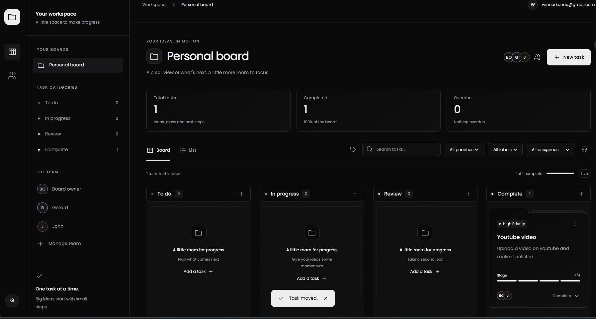
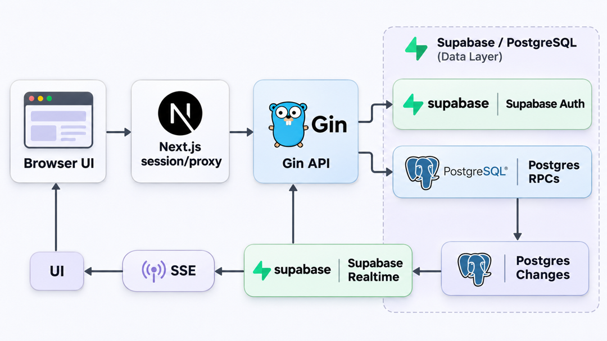

# Next Play Task Manager Assessment

**Author:** Winner Le Paradoxe Konou

This is the single entry repository for the assessment. It contains the Next.js frontend and Go/Gin backend as Git submodules, pinned to the tested production source commits.

## Clone the complete project

```sh
git clone --recurse-submodules https://github.com/Wingrammer/task-manager-assessment.git
cd task-manager-assessment
```

If you already cloned the parent repository:

```sh
git submodule update --init --recursive
```

Use a recursive clone: GitHub's source ZIP does not include submodule contents.

## Live application

- Frontend: https://nextplay-kanban-pi.vercel.app
- Gin API and Swagger: https://nextplay-kanban-api.vercel.app/swagger/index.html

## Board preview



## Repository layout

```text
task-manager-assessment/
  frontend/    Next.js UI, encrypted HttpOnly session and thin Gin proxies
  backend/     Gin API, Supabase Auth, database access, migrations and Realtime
```

Gin owns all business logic, authentication operations, database access, migrations and the Supabase Realtime subscription. Next.js handles presentation and session/proxy routes; it contains no Supabase client or database credentials.

## Architecture



Gin subscribes to Supabase Realtime and relays committed changes to the browser over SSE.

The original histories remain available in the frontend and backend submodules. The parent stores their exact commit IDs so reviewers can reproduce this assessment snapshot.

## Run locally

Prerequisites: Node.js 22.18+ or Node.js 24, pnpm, the Go version in `backend/go.mod` (currently 1.27.3), and a Supabase project.

### 1. Prepare Supabase and Gin

1. Enable anonymous sign-ins and manual identity linking in Supabase Auth.
2. Configure the Auth Site URL and allowed redirects for your frontend. Use `http://localhost:3000` for local development.
3. Apply every file in `backend/supabase/migrations/` in filename order. These migrations define the complete application schema, RLS, controlled database functions and Realtime publication.
4. Create `backend/.env` containing:

```dotenv
SUPABASE_URL=https://YOUR_PROJECT.supabase.co
SUPABASE_PUBLISHABLE_KEY=YOUR_PUBLISHABLE_KEY
PORT=8080
```

Start the API in one terminal:

```sh
cd backend
go mod download
go run .
```

### 2. Start Next.js

Copy `frontend/.env.example` to `frontend/.env.local`. Set:

```dotenv
KANBAN_BACKEND_URL=http://localhost:8080
SESSION_SECRET=YOUR_64_CHARACTER_HEXADECIMAL_SECRET
```

Generate the secret using:

```sh
node -e "console.log(require('crypto').randomBytes(32).toString('hex'))"
```

In a second terminal, starting from the parent repository:

```sh
cd frontend
pnpm install
pnpm dev
```

Open http://localhost:3000. Local Swagger is at http://localhost:8080/swagger/index.html. Keep real environment files out of Git and Supabase configuration in the backend only.

## Features and design

- Guest sessions, email confirmation, password setup and existing-account sign-in.
- Responsive board/list views with Poppins and folder-style task cards.
- Local drag animation, optimistic updates on drop, rollback on failure and last committed write wins.
- Supabase Postgres Changes consumed by Gin and relayed over SSE; streams renew before Vercel's function deadline, and browser tabs share ownership.
- Verified-email workspace invitations with explicit acceptance or decline, team members and multiple task assignees.
- Persistent chronological comments and an atomic task activity timeline.
- Custom labels, calendar due dates, urgency badges, combined search/filters and board-wide statistics.

Invitations currently appear inside the recipient's workspace. Outbound email notifications are a future improvement, along with editable board names and popup scrollbar polish.

## Schema, architecture and checks

- Full SQL schema and policies: `backend/supabase/migrations/`.
- Architecture and tradeoffs: `frontend/docs/architecture.md` and `backend/COLLABORATION.md`.
- Frontend checks, from `frontend/`: `pnpm test`, `pnpm lint`, `pnpm build`.
- Backend checks, from `backend/`: `go test ./...`.
- Invitation authorization checks: run `backend/supabase/tests/email_invitations.sql` in SQL Editor; fixtures are rolled back.

Submodules are intentionally pinned. After changing a child project, commit and push that child first, then commit its updated pointer in this parent repository.
